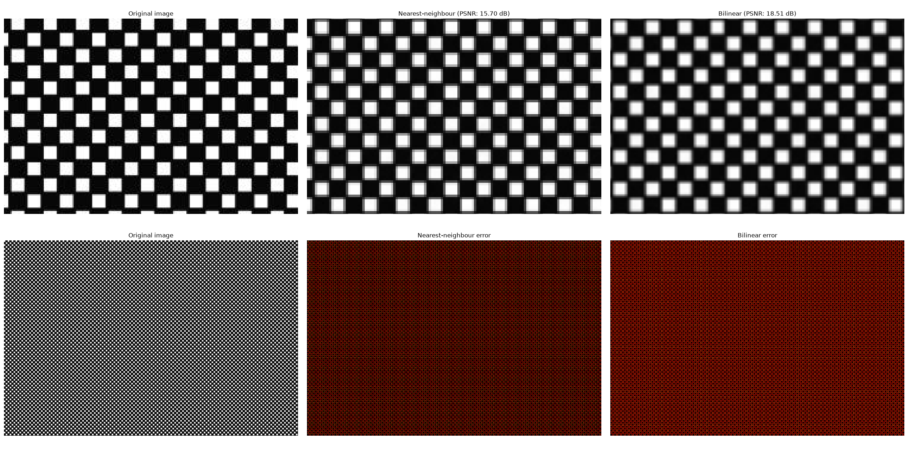

1. Introduction	

Python Libraries

| Library      | Use                                                              |
| --------     | --------                                                         |
| NumPy        | Image arrays, matrix operations, pixel manipulation              |
| SciPy        | Applying convolution with your own Gaussian kernel               |
| Matplotlib   | Displaying images and creating comparison figures and graphs     |
| Pillow (PIL) | Loading images, converting colour modes, saving results	      |
| scikit-image | Image-quality metrics and reference implementations              |

Use of AI tools

This project is mostly handcoded as I believe it will give me a better understanding of the material. I used ChatGPT 5.6 to assist me in certain tasks:

- gather documentation and code snippets from educational websites,
- explain concepts i couldnt grasp as well as i wanted,
- suggest what kind of images to use(e.g. patterns, resolutions) for a variety in the test results,
- help with picking the appropriate python libraries

After I completed the implementation, I also asked for advice for my file structure and cleaner code principles. There were definetely some mistakes!

Last but not least, I used ChatGPT to create a front end website environment so that any user can run the pipeline and see the results!

Results

Interpolation:
